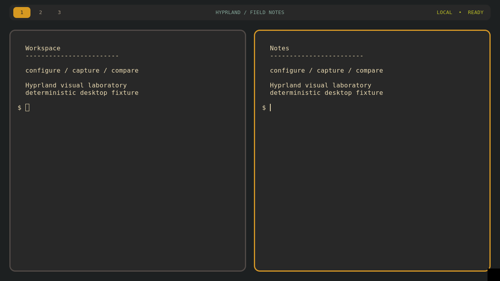

# Hyprland screenshot reconstruction

A native NixOS/KVM task: recreate three supplied screenshots by configuring a
real Hyprland desktop. The agent edits six files for Hyprland, Waybar, Foot, and
Wofi. The fixed VM, packages, fonts, rendering, fixture programs, and display
geometry stay outside the submission.



The screenshots are an original Gruvbox design, inspired by community desktops
surveyed through the official showcase. No third-party dotfiles or wallpapers
are bundled. See `PROVENANCE.md`.

## Public workspace

```sh
python scripts/export_hyprland_task.py logs/hyprland-public-workspace
cd logs/hyprland-public-workspace
nix-build preview.nix --no-out-link --max-jobs 1 --cores 2
```

The result has three `captures/*.png` images. The exporter includes public
fixtures and preview helpers, but excludes `solution/`, `tests/`, private
grading, and validation records. `instruction.md` is the full agent contract.
The first build may download substantial pinned NixOS/GUI dependencies.

## Private grading

On Linux with Nix and usable `/dev/kvm`, from the repository root:

```sh
nix-build hyprland-visual \
  --argstr configDir "$PWD/hyprland-visual/solution/config" \
  --no-out-link --max-jobs 1 --cores 2

python scripts/validate_hyprland.py
```

The grader captures empty, tiled, and launcher scenes, exercises real keyboard
shortcuts and a random shell command, and repeats captures after a cold boot.
Visual regions are checked independently; a large matching background cannot
compensate for a wrong bar, border, terminal, or launcher. It uses normalized RGB
MAE on this fixed renderer, not a vision-model judge or a general semantic
similarity score. Thresholds and the pointer exclusion are public.

Capture readiness requires the launcher to have visibly painted; merely seeing
its registered layer or two unchanged frames is insufficient. This corrected
an observed race during development. Stable captures then wait for consecutive
settled frames. The reference has zero boot-to-boot pixel error on all scenes.

## Claux and OpenRouter

Claux already supports one-shot image attachments and OpenRouter vision inputs:

```sh
claux -p "Compare the target and current desktop" \
  --model YOUR_VISION_PROFILE --image targets/tiled.png --image current/tiled.png
```

MCP image returns are currently omitted by Claux, so this prototype uses an
external screenshot loop instead of relying on an MCP screenshot tool. Each
iteration starts a fresh one-shot context with the targets, latest captures,
previous answer, and existing config files. It is not a continuous multimodal
session. Private grading happens once after the allowed iterations.

The opt-in runner below **makes paid OpenRouter requests** using an existing
credential file. It uses Bubblewrap filesystem/PID isolation to expose only
public task files and system tools. It requires Linux user namespaces, Nix/KVM
for host-side preview/grading, and a Claux binary supporting `--image`:

```sh
python scripts/pilot_hyprland_claux.py \
  --model deepseek/deepseek-v4-flash-vision-exp \
  --binary /path/to/claux --rounds 2 --seconds-per-round 180
```

The model ID is an explicit pilot choice, not a permanent engine default. Its
image and tool support was checked against OpenRouter's public catalog when
preparing this prototype. Future availability may change. API usage/cost is
retained when provided; private transcripts and credentials are not committed.

## Scope

This is a native task prototype, without Harbor packaging. Controls establish
grading behavior, not model difficulty. Pixel scoring is specific to the pinned
software renderer and does not establish perceptual similarity on other hosts,
resolutions, fonts, or package versions. Behavioral checks reject an inert
picture but are not a proof against arbitrary malicious compositor overlays.
See `QUALITY.md` and `validation.json` for measured control results.
